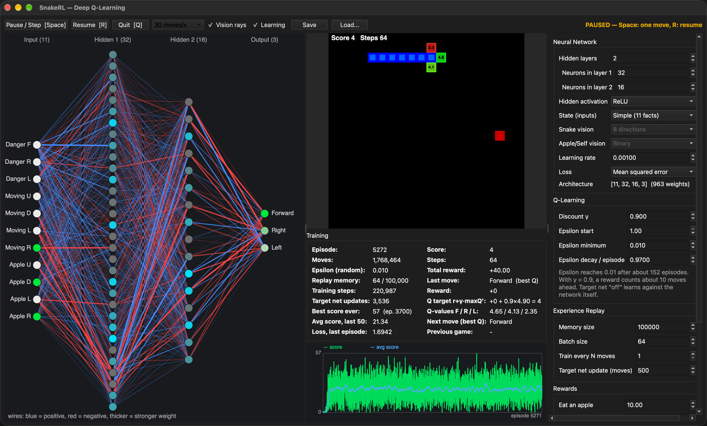

# SnakeRL — a Snake AI trained by Deep Q-Learning

A neural network learns to play the game in `SnakeGame/` (used as is, never changed)
by reinforcement learning: a Deep Q-Network (DQN) built with TensorFlow / Keras.



**Full guide to every part of the dashboard and the ideas behind it:**
[docs/dashboard.html](docs/dashboard.html) (open it in a browser).

## Run
```shell
pip install -r requirements.txt
python main.py                               # dashboard: watch it learn, move by move
python main.py --headless                    # no window: train as fast as possible, Ctrl+C to stop
python main.py --headless -e 300             # ... stop after 300 episodes
python main.py --headless --games 1          # ... one game at a time, like the dashboard (default: 8 at once)
python main.py --load saves/checkpoint.npz   # continue from a checkpoint (either mode)
```

| Key   | Action |
|-------|--------|
| Space | pause; while paused, one move per press (and one learning step), with the Q-value of each next cell shown on the board |
| R     | resume |
| Q     | quit |

In test runs with the default settings (vision state, as SnakeGenetics) the snake ate apples
regularly from about episode 120 and averaged about 22 apples per game by episode 300 (best 47).
With 1/distance vision: about 26 (best 59). Runs vary.

## The idea in one paragraph
The snake (the **agent**) sees a **state** (what its vision rays see, as in SnakeGenetics) and picks one of 3 **actions**
(forward, right, left). The game answers with a **reward** (+10 for an apple, −10 for dying,
0 otherwise) and the next state. A neural network estimates **Q(state, action)**: how much
reward a move will bring, now and later. The agent plays the move with the biggest Q, except
with probability **ε (epsilon)** it plays a random move to **explore**; ε shrinks after every
game. Every move is stored in a **replay memory**, and after each move the network trains on a
random batch of memories, nudging each Q toward the **Bellman target**
`reward + γ · max Q(next state)`.

## The dashboard in brief
The dashboard is the one from SnakeGenetics, with RL statistics and settings.

| Area | What it shows |
|------|---------------|
| **Toolbar** | Pause/Step, Resume, Quit, speed, vision rays on/off, **Learning** on/off, Save, Load, and the run state |
| **Network** (left) | the Q-network. Wires: blue = positive weight, red = negative, thicker = stronger. Neurons light up when they fire; the move with the biggest Q-value is green |
| **Game** (middle) | the original `GameBoard`, with vision rays: grey to the wall, orange = sees its own body, green = sees the apple. While paused, the cells forward / right / left of the head show their Q-values: green = best, red = worst |
| **Training** (below the game) | episode, moves, epsilon, replay memory, training steps, target network updates, best and average score, loss; and for the game on screen: score, steps, total reward, the last move (random or best Q), its reward and its Q target `r + γ·max Q(s′)`, the Q-values now and the next move |
| **Chart** | score per episode and its average over the last 50 |
| **Settings** (right) | network and state, Q-learning, experience replay, rewards, game. **Apply** uses them |

Untick **Learning** to watch what the agent has learned: no random moves, no training.

## The state (setting "State")
* **Vision** (default), the same inputs as SnakeGenetics, 32 numbers: for each of 8 directions,
  1/distance to the wall, apple seen, own body seen; then the head direction and the tail
  direction (4 numbers each). 4 directions and 1/distance vision are options, as there.
* **Simple**, 14 yes/no numbers: a wall forward / right / left, the moving direction
  (R, D, L, U), its own body forward / right / left, and where the apple is (left, right, up,
  down of the head). It learns much sooner, because the answers are handed to it, but it sees
  only one cell ahead, so long snakes trap themselves. Comparing the two shows students that what the agent
  can see matters as much as how it learns.

## Settings, checkpoints and the two modes
* **Apply** saves the settings to `settings.json`; both modes start from it, so `--headless`
  uses what you last applied in the dashboard.
* The **network shape** (state, hidden layers, activation) must match saved weights, so a loaded
  checkpoint brings its own. Everything else can be changed any time; Apply asks whether to keep
  the agent (what it learned and its memory).
* **Save** and headless mode write checkpoints (`saves/*.npz`): settings, network weights,
  epsilon and history. The replay memory is not saved; it refills quickly.
* Keep the grid size even: the game starts the snake at the middle, `grid / 2`.

## Code, in reading order
| File | What it shows |
|------|---------------|
| `RLAgent/environment.py`   | the game as an environment: `get_state()` (vision or simple) and `step(action)` → next state, reward, done |
| `RLAgent/trainer.py`       | the RL loop: choose → move → remember → learn, one `step()` per move |
| `RLAgent/dqn_agent.py`     | the Keras Q-network, epsilon-greedy, and the Q-learning update in `train_on_batch()` |
| `RLAgent/replay_memory.py` | the replay memory and random batches |
| `RLAgent/config.py`        | every setting, with defaults |
| `Dashboard/main_window.py` | the dashboard: calls `trainer.step()` and shows what happened |
| `RLAgent/headless.py`      | the fast mode: the same loop without a window |
| `RLAgent/parallel_trainer.py` | headless only: 8 games at once sharing one agent, one network call for all of them |
| `RLAgent/checkpoint.py`    | save / load |

Compare with [SnakeGenetics](../SnakeGenetics), which trains the same kind of network
with a genetic algorithm instead.
